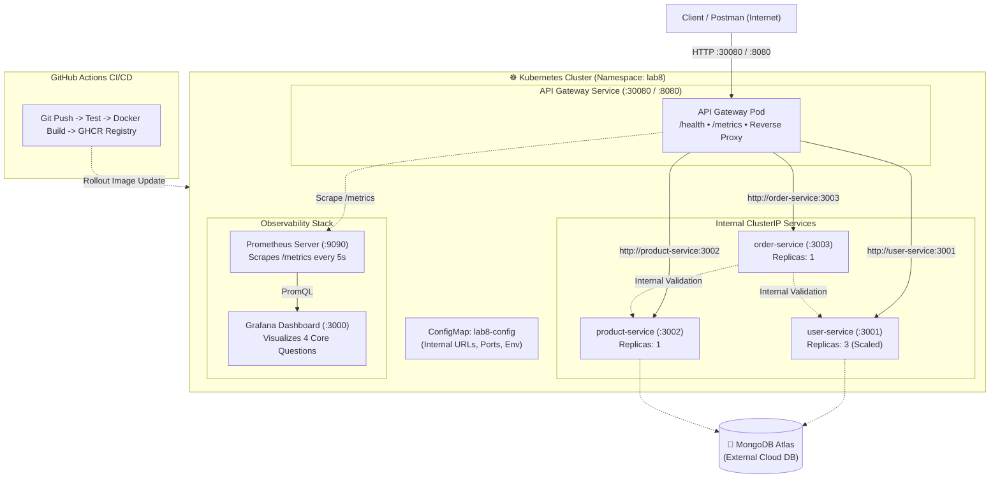

# Lab 8: Kubernetes Orchestration, CI/CD Pipeline & Monitoring

> **Web Services & Service-Oriented Architecture (SOA) Laboratory — Lab 8**  
> **Topic:** Deploying Microservices on Kubernetes, GitHub Actions CI/CD, and Observability with Prometheus & Grafana

---

## 📑 Table of Contents
1. [Executive Summary & Full-Stack Architecture](#1-executive-summary--full-stack-architecture)
2. [Architecture Diagram](#2-architecture-diagram)
3. [Lab 7 Starting Point & Transition](#3-lab-7-starting-point--transition)
4. [Prerequisites & Kubernetes Cluster Verification](#4-prerequisites--kubernetes-cluster-verification)
5. [Part A: Kubernetes Manifests & Deployment](#5-part-a-kubernetes-manifests--deployment)
   - [5.1 Manifests Layout & Structure](#51-manifests-layout--structure)
   - [5.2 Health & Readiness Probes](#52-health--readiness-probes)
   - [5.3 Configuration & Internal Service Discovery](#53-configuration--internal-service-discovery)
   - [5.4 Applying Manifests & Deployment Verification](#54-applying-manifests--deployment-verification)
   - [5.5 External Access via NodePort & Postman Testing](#55-external-access-via-nodeport--postman-testing)
   - [5.6 Scaling Demonstration](#56-scaling-demonstration)
   - [5.7 Self-Healing Demonstration](#57-self-healing-demonstration)
   - [5.8 Troubleshooting Workflow](#58-troubleshooting-workflow)
6. [Part B: GitHub Actions CI/CD Pipeline](#6-part-b-github-actions-cicd-pipeline)
   - [6.1 CI/CD Workflow Stages](#61-cicd-workflow-stages)
   - [6.2 Container Registry & Image Versioning Policy](#62-container-registry--image-versioning-policy)
   - [6.3 Verification & Kubernetes Image Rollout](#63-verification--kubernetes-image-rollout)
7. [Part C: Observability with Prometheus & Grafana](#7-part-c-observability-with-prometheus--grafana)
   - [7.1 Metrics Exposition & Prometheus Scrape Target](#71-metrics-exposition--prometheus-scrape-target)
   - [7.2 Essential PromQL Queries](#72-essential-promql-queries)
   - [7.3 Grafana Dashboard: Answering the 4 Core Questions](#73-grafana-dashboard-answering-the-4-core-questions)
   - [7.4 Traffic Generation & Before/After Observation](#74-traffic-generation--beforeafter-observation)
8. [Deliverables & Evidence Checklist (13 Items)](#8-deliverables--evidence-checklist-13-items)

---

## 1. Executive Summary & Full-Stack Architecture

In **Lab 7**, the CampusConnect microservices system (API Gateway, User Service, Product Service, and Order Service) was composed and run via Docker Compose, relying on external MongoDB Atlas for persistence.

In **Lab 8**, we transition the application into an enterprise-grade DevOps workflow:
- **Kubernetes Orchestration**: Microservices deployed inside a dedicated `lab8` namespace with declarative `Deployment`, `Service`, `ConfigMap`, and health probe specifications.
- **Service Discovery & Resiliency**: Microservices communicate internally using stable Kubernetes Service DNS hostnames (`user-service:3001`, `product-service:3002`, `order-service:3003`). Pod replicas are scaled dynamically and recover automatically through Kubernetes self-healing.
- **CI/CD Automation**: GitHub Actions pipeline that checks out code, runs automated health & unit tests, builds versioned Docker images tagged with Git commit SHAs, and pushes them to GitHub Container Registry (GHCR).
- **Full-Stack Monitoring**: API Gateway exposes Prometheus metrics at `/metrics`. A Prometheus instance scrapes targets and tracks health (`up`) and traffic rates (`rate(http_requests_total[5m])`). A pre-configured Grafana dashboard provides real-time visualization of availability, traffic, errors, and latency.

---

## 2. Architecture Diagram

The complete Lab 8 architecture is illustrated below and available as an SVG file: [`architecture_diagram_lab8.svg`](./architecture_diagram_lab8.svg).



---

## 3. Lab 7 Starting Point & Transition

The application components carried over from Lab 7 without rewriting business logic:
- **`api-gateway`**: Single external entry point routing `/users`, `/products`, `/orders`.
- **`user-service`**: User profile management and student/instructor accounts.
- **`product-service`**: Campus bookstore inventory and product pricing.
- **`order-service`**: Order placement and inter-service HTTP validation with User and Product services.
- **Database**: External MongoDB Atlas managed cluster.

### Lab 7 vs Lab 8 Enhancements:
| Capability | Lab 7 (Docker Compose) | Lab 8 (Kubernetes + CI/CD + Monitoring) |
| :--- | :--- | :--- |
| **Orchestration** | `docker-compose.yml` on single host | Kubernetes Pods, Deployments & Services in `lab8` namespace |
| **Service Discovery** | Docker bridge network DNS aliases | Kubernetes ClusterIP Services with kube-dns |
| **Health Probes** | Basic Docker container restart | Kubernetes `livenessProbe` and `readinessProbe` via `/health` |
| **Scaling & Healing** | Manual restart | `kubectl scale --replicas=3` & automatic pod replacement |
| **CI/CD** | Manual Docker image build | Automated GitHub Actions workflow on Git push |
| **Observability** | Console log inspection | Prometheus metrics collection & Grafana dashboard |

---

## 4. Prerequisites & Kubernetes Cluster Verification

### 4.1 Prerequisites
- **Docker Desktop** (with Kubernetes enabled) OR **Minikube** OR **kind**.
- **kubectl** CLI installed.
- **Postman** (collection provided in `Microservices_Lab8.postman_collection.json`).

### 4.2 Verify Cluster & Context
Execute the following commands to check your active context and ensure at least one node is in `Ready` state:

```powershell
# 1. Check current Kubernetes context
kubectl config current-context

# 2. Confirm available node(s)
kubectl get nodes

# 3. Create the Lab 8 dedicated namespace
kubectl create namespace lab8
# Or apply the manifest:
kubectl apply -f k8s/namespace.yaml
```

**Checkpoint 1:** Show active context and at least one node reporting `Ready`.

---

## 5. Part A: Kubernetes Manifests & Deployment

### 5.1 Manifests Layout & Structure
All Kubernetes manifests are located in the [`k8s/`](./k8s/) directory:

```
k8s/
├── configmap.yaml             # Shared non-sensitive environment variables
├── gateway-deployment.yaml    # API Gateway Deployment (with probes & resource limits)
├── gateway-service.yaml       # API Gateway Service (NodePort: 30080)
├── user-deployment.yaml       # User Service Deployment (replicas: 1 -> 3)
├── user-service.yaml          # User Service ClusterIP Service (Port: 3001)
├── product-deployment.yaml    # Product Service Deployment
├── product-service.yaml       # Product Service ClusterIP Service (Port: 3002)
├── order-deployment.yaml      # Order Service Deployment
├── order-service.yaml         # Order Service ClusterIP Service (Port: 3003)
├── namespace.yaml             # Dedicated lab8 namespace manifest
└── monitoring/                # Observability manifests (Part C)
    ├── prometheus-configmap.yaml
    ├── prometheus.yaml
    └── grafana.yaml
```

### 5.2 Health & Readiness Probes
Every deployment defines `livenessProbe` and `readinessProbe` targeting the HTTP `/health` endpoint:

```yaml
livenessProbe:
  httpGet:
    path: /health
    port: 8080
  initialDelaySeconds: 10
  periodSeconds: 10
  timeoutSeconds: 3
  failureThreshold: 3
readinessProbe:
  httpGet:
    path: /health
    port: 8080
  initialDelaySeconds: 5
  periodSeconds: 5
  timeoutSeconds: 3
  failureThreshold: 2
```

- **Liveness Probe**: Ensures the Node.js event loop is alive. If unresponsive for 3 consecutive checks, Kubernetes restarts the pod.
- **Readiness Probe**: Confirms the container has bound its port and is ready to accept incoming traffic before receiving service requests.

### 5.3 Configuration & Internal Service Discovery
Non-sensitive configuration is stored in `k8s/configmap.yaml`:

```yaml
apiVersion: v1
kind: ConfigMap
metadata:
  name: lab8-config
  namespace: lab8
data:
  NODE_ENV: "production"
  PORT: "8080"
  USER_SERVICE_URL: "http://user-service:3001"
  PRODUCT_SERVICE_URL: "http://product-service:3002"
  ORDER_SERVICE_URL: "http://order-service:3003"
```

- Pods reference this ConfigMap via `envFrom` or `configMapKeyRef`.
- **Never hardcode Pod IPs**: All service communication uses stable internal Kubernetes Service DNS names (`user-service`, `product-service`, `order-service`).

### 5.4 Applying Manifests & Deployment Verification

Apply the manifests to the `lab8` namespace:

```powershell
# Apply all manifests in k8s directory
kubectl apply -f k8s/ -n lab8

# Verify Deployments
kubectl get deployments -n lab8

# Verify Pods (all should reach Running state with 1/1 Ready)
kubectl get pods -n lab8

# Verify Services
kubectl get services -n lab8
```

**Checkpoint 2:** Confirm that `gateway-deployment`, `user-service`, `product-service`, and `order-service` all show `AVAILABLE = 1` and all Pods report `Running` and `Ready (1/1)`.

### 5.5 External Access via NodePort & Postman Testing

The API Gateway is exposed outside the cluster via `gateway-service.yaml` as a **NodePort** service on port `30080`:

```yaml
spec:
  type: NodePort
  ports:
    - name: http
      port: 8080
      targetPort: 8080
      nodePort: 30080
```

#### Access Options:
- **NodePort direct URL**: `http://localhost:30080` (or `http://<Node-IP>:30080`)
- **Port-forward alternative**:
  ```powershell
  kubectl port-forward svc/gateway-service 8080:8080 -n lab8
  ```
  Then access via `http://localhost:8080`.

#### Postman Testing Suite:
Import [`Microservices_Lab8.postman_collection.json`](./Microservices_Lab8.postman_collection.json):
1. **GET `/health`**: Returns gateway status and service registry.
2. **GET `/users`**: Retrieves all users from User Service via Gateway.
3. **GET `/products`**: Retrieves catalog from Product Service via Gateway.
4. **POST `/orders`**: Submits an order through Gateway; Order Service internally validates user with `http://user-service:3001` and product with `http://product-service:3002`.

### 5.6 Scaling Demonstration

To demonstrate horizontal scalability:

```powershell
# Scale user-service from 1 replica to 3 replicas
kubectl scale deployment user-service --replicas=3 -n lab8

# Observe the 3 user-service pods running
kubectl get pods -n lab8 -l app=user-service
```

- Kubernetes load balances incoming requests across all 3 healthy pods behind the stable `user-service:3001` ClusterIP.

### 5.7 Self-Healing Demonstration

To demonstrate Kubernetes self-healing and desired-state reconciliation:

```powershell
# 1. List current running pods
kubectl get pods -n lab8 -l app=user-service

# 2. Delete one pod (replace <pod-name> with an active pod)
kubectl delete pod <pod-name> -n lab8

# 3. Immediately inspect pods again
kubectl get pods -n lab8 -l app=user-service
```

- **Observation**: Kubernetes immediately recognizes that actual replicas (2) < desired replicas (3) and spawns a replacement pod (`ContainerCreating` -> `Running`).

### 5.8 Troubleshooting Workflow

When debugging Kubernetes workloads:

```powershell
# Inspect pod lifecycle events, probe failures, and image status
kubectl describe pod <pod-name> -n lab8

# Read live container application logs
kubectl logs <pod-name> -n lab8

# Verify that service selector matches active pod endpoints
kubectl get endpoints -n lab8
```

---

## 6. Part B: GitHub Actions CI/CD Pipeline

The CI/CD workflow is located in [`.github/workflows/ci.yml`](./.github/workflows/ci.yml).

### 6.1 CI/CD Workflow Stages
1. **Trigger**: Executes on every `push` or `pull_request` to `main` and `master`.
2. **Build & Test Stage (`test-services`)**:
   - Runs on `ubuntu-latest`.
   - Matrix strategy parallelizes testing for all 4 microservices (`api-gateway`, `user-service`, `product-service`, `order-service`).
   - Runs `npm install` and executes `npm test`.
3. **Docker Build & Registry Stage (`build-and-push-images`)**:
   - Executes only after all tests pass.
   - Builds production Docker images using Docker Buildx.
   - Tags each image with the exact Git commit SHA (`${{ github.sha }}`) and `latest`.
   - Securely pushes versioned images to **GitHub Container Registry (GHCR)** using `${{ secrets.GITHUB_TOKEN }}`.

### 6.2 Container Registry & Image Versioning Policy
Images are tagged deterministically:
```
ghcr.io/<repository-owner>/api-gateway:<GITHUB_SHA>
ghcr.io/<repository-owner>/user-service:<GITHUB_SHA>
ghcr.io/<repository-owner>/product-service:<GITHUB_SHA>
ghcr.io/<repository-owner>/order-service:<GITHUB_SHA>
```
Using the commit SHA ensures full traceability from git commit to running Kubernetes container.

### 6.3 Kubernetes Image Rollout
To deploy the versioned image produced by CI/CD into Kubernetes:

```powershell
kubectl set image deployment/user-service user-service=ghcr.io/<username>/user-service:<GITHUB_SHA> -n lab8
kubectl rollout status deployment/user-service -n lab8
```

---

## 7. Part C: Observability with Prometheus & Grafana

### 7.1 Metrics Exposition & Prometheus Scrape Target
- **Endpoint**: The API Gateway exposes standard Prometheus metrics at [`/metrics`](http://localhost:8080/metrics).
- **Instrumentation**: Implemented in [`api-gateway/metrics.js`](./api-gateway/metrics.js) measuring:
  - `http_requests_total{method, route, status}` (Counter)
  - `http_request_duration_seconds` (Histogram with duration buckets)
  - `process_uptime_seconds`, `process_resident_memory_bytes`, `nodejs_heap_size_used_bytes`

#### Prometheus Configuration (`k8s/monitoring/prometheus-configmap.yaml`):
```yaml
scrape_configs:
  - job_name: "gateway"
    metrics_path: "/metrics"
    static_configs:
      - targets: ["gateway-service:8080"]
```

### 7.2 Essential PromQL Queries
| Question / Metric | PromQL Expression | Purpose |
| :--- | :--- | :--- |
| **Availability (UP)** | `up{job="gateway"}` | Returns `1` if Gateway target is healthy, `0` if unreachable |
| **Traffic Arrival Rate** | `sum(rate(http_requests_total[1m])) by (route, method)` | Calculates request arrival rate (req/s) per route |
| **Failure Rate (Errors)** | `sum(rate(http_requests_total{status=~"[45].."}[1m])) or vector(0)` | Detects rate of 4xx client errors and 5xx server faults |
| **Average Latency** | `sum(rate(http_request_duration_seconds_sum[1m])) / sum(rate(http_request_duration_seconds_count[1m]))` | Measures average request processing duration in seconds |
| **Total Requests** | `sum(http_requests_total)` | Total count of all requests processed since start |

### 7.3 Grafana Dashboard: Answering the 4 Core Questions

The dashboard definition is saved in [`monitoring/grafana-dashboard.json`](./monitoring/grafana-dashboard.json). It provides dedicated panels answering each question:

1. **"Are targets reachable?"**: Single-stat gauge showing Gateway status (`UP` in green when `up == 1`).
2. **"How much traffic is arriving?"**: Real-time time series graph tracking traffic rate per route.
3. **"Are failures increasing?"**: Error rate gauge turning amber on 4xx/5xx errors and red during outages.
4. **"How long are requests taking?"**: Latency time series tracking duration in seconds.

#### Deploying Observability Stack:
- **In Kubernetes**:
  ```powershell
  kubectl apply -f k8s/monitoring/ -n lab8
  # Prometheus available at: http://localhost:30090
  # Grafana available at:    http://localhost:30300 (admin / admin)
  ```
- **Via Docker Compose**:
  ```powershell
  docker compose -f docker-compose.monitoring.yml up -d
  # Prometheus available at: http://localhost:9090
  # Grafana available at:    http://localhost:3000 (admin / admin)
  ```

### 7.4 Traffic Generation & Before/After Observation

We provide an automated traffic generation script [`scripts/generate-traffic.js`](./scripts/generate-traffic.js) that generates normal requests as well as controlled 404 error traffic:

```powershell
# Run 25 batches against the running gateway
node scripts/generate-traffic.js http://localhost:8080 25
# Or targeting NodePort:
node scripts/generate-traffic.js http://localhost:30080 25
```

- **Before Traffic**: Prometheus query `rate(http_requests_total[1m])` is at or near `0`.
- **During/After Traffic**: Request rate increases visibly on Grafana timeseries charts, and controlled 404 errors register on the failure rate panel.

---

## 8. Deliverables & Evidence Checklist (13 Items)

Use this table to capture the exact evidence required by the Lab 8 evaluation rubric:

| No. | Rubric Item | Required Evidence | Command / Source File |
| :---: | :--- | :--- | :--- |
| **1** | **Lab 7 Baseline** | Successful Postman request/response through gateway | Postman GET `http://localhost:8080/health` or `/users` |
| **2** | **K8s Environment** | Current context & node status | `kubectl config current-context`<br>`kubectl get nodes` |
| **3** | **Manifests** | Gateway, service, and configuration YAML files | Directory listing of [`k8s/`](./k8s/) & YAML file contents |
| **4** | **Deployment** | Pods, Deployments & Services in `lab8` | `kubectl get all -n lab8` |
| **5** | **Gateway Test** | Successful request through K8s gateway | Postman request to `http://localhost:30080/health` or `/products` |
| **6** | **Scaling** | User Service scaled to 3 replicas | `kubectl scale deployment user-service --replicas=3 -n lab8`<br>`kubectl get pods -n lab8` |
| **7** | **Self-Healing** | Deleted pod followed by replacement | `kubectl delete pod <pod-name> -n lab8`<br>`kubectl get pods -n lab8 -w` |
| **8** | **Troubleshooting** | Useful describe/logs/endpoints output | `kubectl describe pod <name> -n lab8`<br>`kubectl get endpoints -n lab8` |
| **9** | **GitHub Actions** | Successful CI workflow run | GitHub Actions tab showing passing `test-services` & `build-and-push-images` |
| **10** | **Prometheus** | Targets page reporting `UP` + PromQL query | Prometheus Targets page (`/targets`) & PromQL `up`, `rate(...)` |
| **11** | **Grafana** | Monitoring dashboard | Dashboard view showing the 4 monitoring panels |
| **12** | **Traffic Observation** | Dashboard comparison after traffic | Output of `node scripts/generate-traffic.js` + Grafana traffic spike |
| **13** | **Architecture** | Final architecture diagram | [`architecture_diagram_lab8.svg`](./architecture_diagram_lab8.svg) |

---

## 9. Security & Best Practices Adherence

- **No Secrets in Source Control**: Sensitive database credentials and tokens are kept in environment variables or Kubernetes Secrets; they are never committed to git.
- **Service Isolation**: Internal microservices (`user-service`, `product-service`, `order-service`) use internal `ClusterIP` services and are not exposed externally. Only `gateway-service` is accessible outside.
- **Deterministic Versioning**: Docker image artifacts are tagged with Git commit SHAs rather than mutable `latest` tags in CI/CD delivery.
