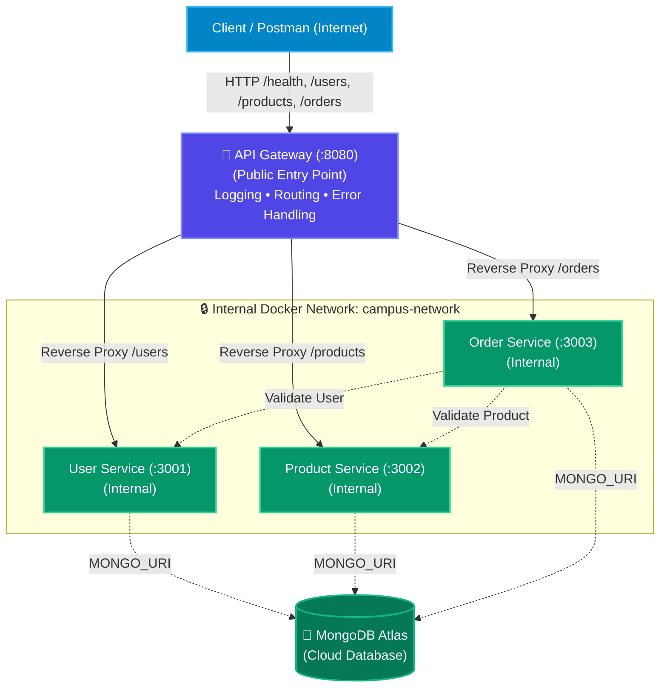

# Lab 7: API Gateway, Service Discovery & Cloud Deployment

> **Web Services & Service-Oriented Architecture (SOA) Laboratory — Lab 7**  
> **Topic:** Building a Real API Gateway, Configuration-Based Service Discovery & Cloud Deployment with MongoDB Atlas

---

## 📑 Table of Contents
1. [Executive Summary & Full-Stack Architecture](#1-executive-summary--full-stack-architecture)
2. [Architecture Diagram](#2-architecture-diagram)
3. [Discussion 1: Why Introduce an API Gateway?](#3-discussion-1-why-introduce-an-api-gateway)
4. [Discussion 2: Static Config vs Dynamic Service Discovery](#4-discussion-2-static-config-vs-dynamic-service-discovery)
5. [Part A: API Gateway Implementation & Routing](#5-part-a-api-gateway-implementation--routing)
6. [Part B: Configuration-Based Service Discovery](#6-part-b-configuration-based-service-discovery)
7. [Part C: Cloud Deployment & MongoDB Atlas Setup](#7-part-c-cloud-deployment--mongodb-atlas-setup)
8. [Docker Compose & Network Security](#8-docker-compose--network-security)
9. [Postman Testing Suite & Verification Guide](#9-postman-testing-suite--verification-guide)
10. [Written Reflection (Lab 6 vs Lab 7)](#10-written-reflection-lab-6-vs-lab-7)
11. [Troubleshooting & FAQs](#11-troubleshooting--faqs)

---

## 1. Executive Summary & Full-Stack Architecture

In **Lab 6**, the backend was decomposed into three independently runnable microservices communicating over a shared Docker network, with the API Gateway introduced only as a concept.

In **Lab 7**, we make that concept real:
- **`api-gateway` Service**: Acts as the single, public entry point for all client requests (running on port `8080`).
- **Network Boundary**: Internal microservices (`user-service`, `product-service`, `order-service`) are **not** exposed to the outside world; they reside solely on the internal `campus-network`.
- **Lightweight Service Discovery**: The Gateway dynamically builds its routing table from environment variables (`USER_SERVICE_URL`, `PRODUCT_SERVICE_URL`, `ORDER_SERVICE_URL`) rather than hard-coding URLs.
- **Centralized Resilience**: Graceful `502 Bad Gateway` / `503 Service Unavailable` handling when any downstream microservice is offline.
- **Cloud-Ready Deployment**: Configured for seamless deployment on container cloud platforms (Render, Railway, Fly.io) with persistent storage via **MongoDB Atlas**.

---

## 2. Architecture Diagram

The architectural diagram is available in SVG format: [`architecture_diagram_lab7.svg`](./architecture_diagram_lab7.svg).



---

## 3. Discussion 1: Why Introduce an API Gateway?

> **Question:** *Why introduce an API Gateway instead of letting clients call each service directly?*

### Key Reasons:
1. **Single Entry Point & Encapsulation:** Clients interact with one unified domain/port (`/users`, `/products`, `/orders`) without needing to track multiple ports or host addresses.
2. **Security & Hiding Internal Architecture:** Backend microservices remain shielded inside private Docker networks. External clients cannot directly probe or exploit internal microservice ports.
3. **Centralized Cross-Cutting Concerns:** Logging, authentication, CORS, rate limiting, and SSL termination are handled centrally at the gateway rather than duplicated across every microservice.
4. **Resilience & Graceful Degradation:** If an internal service fails, the gateway intercepts connection errors (`ECONNREFUSED` / timeouts) and returns standardized, user-friendly `502/503` responses instead of crashing or leaking raw stack traces.

---

## 4. Discussion 2: Static Config vs Dynamic Service Discovery

> **Question:** *Contrast the static/config-based approach with dynamic service discovery (e.g. Consul, Eureka, Kubernetes DNS). What would a dynamic registry add that a static config file cannot?*

| Feature | Static / Config-Based Discovery (Lab 7) | Dynamic Service Discovery (Consul / Eureka / K8s) |
| :--- | :--- | :--- |
| **Registration** | Manually declared in `.env` / config files | Services self-register on startup via heartbeat APIs |
| **Auto-Scaling** | Fixed URLs; cannot dynamically discover newly spawned replicas | Automatically tracks 10+ dynamically scaled container instances |
| **Health Deregistration** | Unhealthy services remain in config until manual restart | Automatically evicts unhealthy nodes in real time |
| **Zero-Downtime Reconfiguration** | Requires gateway reload/restart to read new environment variables | Live updates to routing table via DNS or push notifications without restarts |
| **Complexity** | Extremely simple, lightweight, zero extra infrastructure | Requires dedicated registry cluster and client sidecars/agents |

---

## 5. Part A: API Gateway Implementation & Routing

The API Gateway is built in Node.js using `express` and `http-proxy-middleware`:

### Gateway Endpoint Mapping:
| Public Gateway Endpoint | Target Service | Example Request |
| :--- | :--- | :--- |
| `GET /health` | Handled by Gateway directly | `GET http://localhost:8080/health` |
| `GET /users` | User Service | `GET http://localhost:8080/users` |
| `GET /users/:id` | User Service | `GET http://localhost:8080/users/101` |
| `POST /users` | User Service | `POST http://localhost:8080/users` |
| `GET /products` | Product Service | `GET http://localhost:8080/products` |
| `GET /products/:id` | Product Service | `GET http://localhost:8080/products/501` |
| `POST /products` | Product Service | `POST http://localhost:8080/products` |
| `GET /orders` | Order Service | `GET http://localhost:8080/orders` |
| `POST /orders` | Order Service | `POST http://localhost:8080/orders` |

---

## 6. Part B: Configuration-Based Service Discovery

All target backend URLs are decoupled into environment variables:
```javascript
const serviceRegistry = {
  userService: process.env.USER_SERVICE_URL || 'http://user-service:3001',
  productService: process.env.PRODUCT_SERVICE_URL || 'http://product-service:3002',
  orderService: process.env.ORDER_SERVICE_URL || 'http://order-service:3003'
};
```
Routes reference `serviceRegistry` dynamically. Changing a port or host in `.env` reconfigures the gateway with zero code modifications.

---

## 7. Part C: Cloud Deployment & MongoDB Atlas Setup

### 1. MongoDB Atlas Configuration
1. Create a free cluster on [MongoDB Atlas](https://www.mongodb.com/cloud/atlas).
2. Create a Database User (e.g. `campus_admin`) and whitelist network access (`0.0.0.0/0`).
3. Obtain connection URI:
   ```env
   MONGO_URI=mongodb+srv://campus_admin:<password>@cluster0.mongodb.net/campusconnect?retryWrites=true&w=majority
   ```

### 2. Deploying Containers to Cloud (e.g. Render / Railway / Fly.io)
1. Push repository to GitHub.
2. In **Render** or **Railway**, create a **New Web Service / Docker Compose Service**.
3. Set environment variables:
   - `PORT=8080`
   - `USER_SERVICE_URL=http://user-service:3001`
   - `PRODUCT_SERVICE_URL=http://product-service:3002`
   - `ORDER_SERVICE_URL=http://order-service:3003`
   - `MONGO_URI=<your-mongodb-atlas-uri>`
4. The cloud platform exposes a public URL: `https://campusconnect-gateway.onrender.com`.

---

## 8. Docker Compose & Network Security

In [`docker-compose.yml`](./docker-compose.yml):
- **Only the API Gateway exposes port `8080:8080` externally.**
- Microservices (`user-service`, `product-service`, `order-service`) have **no external port mappings**.
- All containers join the private bridge network `campus-network`.

### Running with Docker Compose:
```bash
# Build and run all services
docker compose up --build -d

# Check running status
docker compose ps

# View live gateway logs
docker compose logs -f api-gateway

# Stop all services
docker compose down
```

---

## 9. Postman Testing Suite & Verification Guide

Import [`Microservices_Lab7.postman_collection.json`](./Microservices_Lab7.postman_collection.json) into Postman.

### Testing Sequence:
1. **Gateway Health Check:**
   - `GET {{GATEWAY_URL}}/health` $\rightarrow$ `200 OK` (returns service registry).
2. **User Operations via Gateway:**
   - `GET {{GATEWAY_URL}}/users` $\rightarrow$ `200 OK` (Aarav Sharma, Priya Patel, Rohan Verma).
3. **Product Operations via Gateway:**
   - `GET {{GATEWAY_URL}}/products/501` $\rightarrow$ `200 OK` (Engineering Mathematics `₹650`).
4. **Order Creation (Full End-to-End Flow):**
   - `POST {{GATEWAY_URL}}/orders` $\rightarrow$ `201 Created` (Gateway routes to Order Service $\rightarrow$ Order Service validates with User & Product services $\rightarrow$ Order persisted).
5. **Gateway Fault Tolerance (503):**
   - Stop user service: `docker stop user-service`.
   - `GET {{GATEWAY_URL}}/users` $\rightarrow$ `503 Service Unavailable` returned by Gateway.
   - Restart user service: `docker start user-service` $\rightarrow$ returns `200 OK`.

---

## 10. Written Reflection (Lab 6 vs Lab 7)

> **Reflection (5–8 Lines):**  
> Moving from Lab 6 to Lab 7 transformed our application from a loosely coupled set of exposed microservices into a unified, secure, enterprise-grade distributed system. In Lab 6, clients directly accessed individual service ports (`:3001`, `:3002`, `:3003`), exposing internal architecture and multiplying network complexity. In Lab 7, introducing the API Gateway established a single public entry point (`:8080`), isolating backend services within a private Docker network and centralizing cross-cutting concerns like routing, logging, and error handling. Furthermore, transitioning from localhost to cloud deployment with MongoDB Atlas completed the full-stack lifecycle, making the services accessible to any client over the internet with persistent cloud storage.

---

## 11. Troubleshooting & FAQs

| Problem | Cause | Resolution |
| :--- | :--- | :--- |
| `503 Service Unavailable` from Gateway | Target microservice is offline or network is down | Check container status using `docker compose ps`. Restart service using `docker compose up -d`. |
| `404 Route Not Found` | Request path does not match `/health`, `/users`, `/products`, `/orders` | Verify endpoint URL against the Gateway routing table. |
| Cannot access `:3001` directly | Microservice ports are shielded inside Docker | As per Lab 7 security design, all requests must pass through Gateway (`:8080`). |
